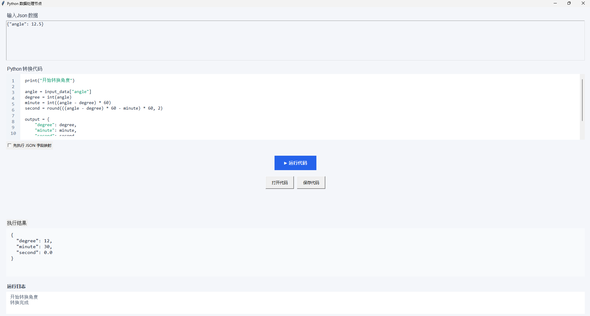

# JSON Semantic Mapper

一个支持 Python 可编程数据处理节点的 JSON 数据转换工具。

本项目在原有 JSON Schema 解析、字段映射和数据转换功能的基础上，
增加了 Python 代码处理节点。

用户可以通过图形化代码编辑器输入 JSON 数据、编写 Python 转换逻辑，
并运行代码，获得所需的 JSON 输出结果。

项目同时保留原有的字段映射、Schema 校验和多源数据组装功能。

## 项目功能

- 解析 JSON Schema，提取字段名称、路径、类型和描述
- 根据字段名称、描述和类型生成候选映射
- 使用 DeepSeek API 辅助识别语义相同的字段
- 对 LLM 生成的候选映射进行程序校验
- 通过人工审核确认映射规则
- 生成声明式 MappingSpec
- 根据 MappingSpec 执行确定性 JSON 转换
- 支持单源 JSON 转换及多源 JSON 组装
- 校验 Schema 指纹、字段类型和必填字段
- 提供 Python API，便于其他项目集成
- 使用 pytest 进行自动化测试

## 核心设计

项目采用模块化设计，支持两种数据处理模式。

### 独立 Python 代码节点

JSON 输入 → Python 代码处理 → JSON 输出

用户可以直接编写 Python 代码，实现自定义数据转换，
不依赖大语言模型。

### JSON 映射与 Python 代码结合

JSON 输入 → 字段映射 → Python 代码处理 → 输出校验

系统先执行 MappingSpec 中的字段映射规则，
再将映射结果传入 Python 代码节点进行处理。

目前实现的是固定顺序的两节点工作流。

## 环境要求

- Python 3.12
- Windows 11（当前开发环境）
- pip
- pytest
- openai（调用 DeepSeek API）

## 安装方法

克隆项目：

```bash
git clone https://github.com/hyverysmart/json-semantic-mapper.git
cd json-semantic-mapper
```

创建虚拟环境：

```bash
python -m venv .venv
```

Windows PowerShell 激活虚拟环境：

```powershell
.venv\Scripts\Activate.ps1
```

安装依赖：

```bash
python -m pip install -r requirements.txt
```

## DeepSeek API 配置

项目支持使用 DeepSeek 生成候选语义映射。

在 PowerShell 中设置环境变量：

```powershell
$env:DEEPSEEK_API_KEY="your_api_key"
```

真实 DeepSeek 模式：

```bash
python src/llm_mapper.py --mode deepseek
```

模拟模式：

```bash
python src/llm_mapper.py --mode mock
```

注意：

- API Key 不应写入源代码或提交到 GitHub
- 使用真实 DeepSeek API 可能产生费用
- LLM 生成的是候选映射，不能直接视为审核通过的规则

## MappingSpec 人工审核

使用 DeepSeek 候选映射：

```bash
python src/mapping_spec.py --provider deepseek
```

使用 Mock 候选映射：

```bash
python src/mapping_spec.py --provider mock
```

程序会展示候选映射，使用者确认后生成 MappingSpec。

MappingSpec 记录字段来源、目标路径、规则和 Schema 指纹等信息。

## 命令行使用方法
### 启动 Python 代码编辑器

```bash
python -m src.code_editor
```

启动后，用户可以：

- 输入 JSON 数据
- 编写 Python 转换代码
- 选择是否先执行字段映射
- 点击运行或使用 Ctrl + Enter
- 查看转换结果和运行日志
- 保存及打开 Python 代码

### 单源 JSON 转换

```bash
python main.py --mode single
```

程序读取示例输入及已审核的 MappingSpec，并执行确定性转换。

输出：

`outputs/transformed_student.json`

### 多源 JSON 组装

```bash
python main.py --mode multi
```

程序使用学生基本信息和成绩两个来源，组装成目标 JSON。

输出：

`outputs/multi_source_result.json`

## Python API

项目通过 `src/mapper_service.py` 提供 Python 调用接口。

### 单源转换

```python
import json

from src.mapper_service import transform_single


def load_json(path):
    with open(path, "r", encoding="utf-8") as file:
        return json.load(file)


source_data = {
    "studentId": 2002,
    "studentName": "Amy",
    "score": 88.5
}

mapping_spec = load_json("outputs/mapping_spec.json")
source_schema = load_json("schemas/source_schema.json")
target_schema = load_json("schemas/target_schema.json")

result = transform_single(
    source_data=source_data,
    mapping_spec=mapping_spec,
    source_schema=source_schema,
    target_schema=target_schema
)

print(result)
```

转换结果：

```json
{
  "id": 2002,
  "name": "Amy",
  "grade": 88.5
}
```

### 多源组装

```python
import json

from src.mapper_service import transform_multi


def load_json(path):
    with open(path, "r", encoding="utf-8") as file:
        return json.load(file)


sources = {
    "student_info": {
        "studentId": 2002,
        "studentName": "Amy"
    },
    "student_score": {
        "score": 88.5
    }
}

schemas = {
    "student_info": load_json(
        "schemas/student_info_schema.json"
    ),
    "student_score": load_json(
        "schemas/student_score_schema.json"
    )
}

mapping_spec = load_json(
    "outputs/multi_source_mapping_spec.json"
)

target_schema = load_json("schemas/target_schema.json")

result = transform_multi(
    sources=sources,
    mapping_spec=mapping_spec,
    schemas=schemas,
    target_schema=target_schema
)

print(result)
```

### 运行完整 API 示例

```bash
python -m examples.api_usage
```

研究生可以参考 `examples/api_usage.py`，将示例数据替换成自己的 JSON 数据和对应的 Schema、MappingSpec。

## 自动化测试

运行全部测试：

```bash
python -m pytest -v
```

测试 Python API：

```bash
python -m pytest tests/test_mapper_service.py -v
```

测试多源组装：

```bash
python -m pytest tests/test_multi_source_assembler.py -v
```

测试数据校验：

```bash
python -m pytest tests/test_validation.py -v
```

## 项目结构

```text
json-semantic-mapper/
├── main.py
├── README.md
├── requirements.txt
├── src/
│   ├── schema_parser.py
│   ├── field_mapper.py
│   ├── llm_mapper.py
│   ├── mapping_spec.py
│   ├── json_transformer.py
│   ├── multi_source_assembler.py
│   ├── generate_multi_source_spec.py
│   └── mapper_service.py
├── schemas/
├── examples/
│   └── api_usage.py
├── outputs/
└── tests/
    ├── test_validation.py
    ├── test_multi_source_assembler.py
    └── test_mapper_service.py
```

## 当前限制

- 当前工作流采用固定的两节点顺序，尚不支持自由插入和编排节点。
- 完整工作流使用预设的 MappingSpec 和 JSON Schema。
- Python 代码执行使用 subprocess 和 exec，不是安全沙箱。
- 当前仅适合执行本地可信代码，不应直接开放给不可信用户。
- 代码编辑器目前是基于 Tkinter 的本地图形界面。
- DeepSeek 语义映射属于原有可选功能，Python 代码处理节点无需调用 LLM。

## 使用说明

本项目适用于需要进行 JSON 字段语义映射、数据转换与多源组装的研究原型及 Python 集成场景。

建议在接入实际业务之前，先使用自身 Schema 和测试数据完成验证。


## Python 代码处理节点

本项目在原有 JSON 字段映射功能的基础上，增加了 Python 代码处理节点，允许用户通过编程实现自定义数据转换。

### 主要功能

- 在图形界面中输入 JSON 数据
- 编写和执行 Python 转换代码
- 支持独立代码执行和固定的两节点工作流
- 显示 JSON 转换结果和 print() 运行日志
- 支持代码保存、打开、行号和基础语法高亮
- 支持 Ctrl + Enter 快捷键运行

### 启动代码编辑器

在项目根目录执行：

```bash
python -m src.code_editor
```

### 使用示例：度转度分秒

输入 JSON：

```json
{
  "angle": 12.5
}
```

Python 转换代码：

```python
angle = input_data["angle"]

degree = int(angle)
minute = int((angle - degree) * 60)
second = round(((angle - degree) * 60 - minute) * 60, 2)

output = {
    "degree": degree,
    "minute": minute,
    "second": second
}
```

执行结果：

```json
{
  "degree": 12,
  "minute": 30,
  "second": 0.0
}
```

### 两种运行模式

**独立代码节点模式：**

JSON 输入 → Python 代码处理 → JSON 输出

**完整工作流模式：**

JSON 输入 → JSON 字段映射 → Python 代码处理 → JSON 输出

### 自动化测试

```bash
python -m unittest discover -s tests -v
```

### 当前限制

- 工作流目前采用固定的两节点顺序，暂不支持任意位置插入节点
- 完整工作流目前使用预设的 MappingSpec 和 Schema
- Python 执行器仅适合运行本地可信代码，尚不具备运行不可信代码的安全沙箱能力

### 代码编辑器运行演示

下图展示用户输入 JSON 数据、编写 Python 转换代码，
并运行代码获得转换结果的完整过程。

